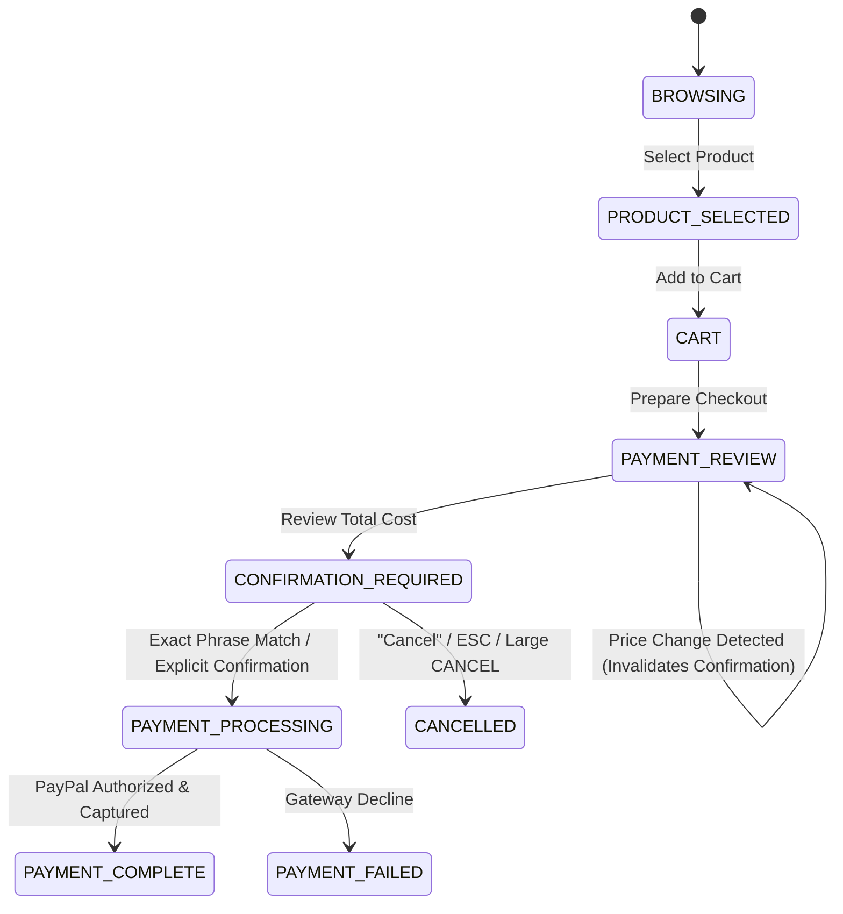

# ACCESSPAY AI

> **"AI does the navigating. You make the decisions."**

AccessPay AI is an accessibility-first agentic commerce platform designed primarily for people with severe motor disabilities who find traditional mouse navigation, precision touchscreens, repetitive typing, and complex multi-step checkouts physically exhausting or impossible.

---

## 1. Product Vision & Core Philosophy

### Autonomous Shopping. User-Controlled Spending.
Online shopping requires hundreds of micro-interactions: precise clicking, scrolling, comparing small table cells, selecting dropdown variants, entering coupon codes, and navigating multi-page checkouts. For individuals with conditions like cerebral palsy, ALS, muscular dystrophy, spinal cord injuries, or severe tremors, these interactions impose extreme physical fatigue.

**Key Tenets:**
1. **The user is fully capable of making their own financial decisions.**
2. **AccessPay is NOT a caregiver-control system.**
3. **AccessPay does NOT decide whether a disabled person is allowed to spend money.**
4. **AI handles physically demanding parts of commerce (search, filter, compare, rank, prepare cart), while the user retains explicit, deliberate control over product selection and every single payment.**

$$\text{Lower Physical Effort} + \text{Greater Shopping Independence} + \text{Explicit Payment Control}$$

---

## 2. Hackathon Target Alignments & Sponsor Integrations

AccessPay AI was engineered with deep, purposeful integration of every target sponsor:

| Sponsor / Category | Role in AccessPay AI | Implementation Details |
| :--- | :--- | :--- |
| **PayPal + AI** | **The Trusted Checkout Platform** | PayPal Sandbox Orders API v2 integration (`POST /v2/checkout/orders` & `/capture` via `/api/payments/paypal/create-order` and `/api/payments/paypal/capture-order/{order_id}`). Server-controlled total calculation, explicit user confirmation gate, duplicate-payment idempotency locks, and accessible decline handling. *Agent Ready integration path identified; current prototype uses PayPal Sandbox Checkout/Orders API.* |
| **Agentic Commerce** | **Autonomous Navigation Engine** | AI interprets high-level intents, tracks multi-turn conversational context, filters by documented accessibility features, explains ranking rationales, proactively finds cheaper alternatives, and stops strictly before payment. |
| **AG Grid** | **Accessible Data Grid & Audit Log** | High-density keyboard-navigable grid for product comparison (`AGGridProductComparison`) and purchase history audit dashboard (`AGGridPurchaseDashboard`) with natural language AI command filtering. |
| **APIMatic** | **Developer Platform & SDK Engine** | Machine-readable OpenAPI 3.1 specification (`apimatic/accesspay-openapi.json`) and portal configuration to generate multi-language SDKs (TypeScript, Python, C#, Java, Go, PHP) so external commerce sites can embed AccessPay confirmation gates. |
| **Bryntum** | **Accessible Commerce Timeline** | Visual scheduler displaying expected delivery dates, upcoming subscription charges, and trial expiration milestones with natural language query capabilities ("What payments are coming next week?"). |
| **Channel3** | **Multi-Retailer Product Discovery** | `ProductService` connects to Channel3 E-commerce API (`https://api.channel3.ai/v1`) to retrieve real products across retailers with documented accessibility attributes, with seamless fallback to our curated catalog. |
| **Render** | **Cloud Deployment Infrastructure** | Production-ready `render.yaml` Blueprint defining zero-downtime Python FastAPI web service and React static site with multi-service health checks (`/health`). |
| **Accessibility / Impact** | **WCAG 2.2 AA Compliance** | Voice-first shopping, Large Controls Mode (64px targets), Keyboard navigation (no traps, 3px focus rings), Switch-Compatible Mode (browser scanning simulation with Space activation), dual aria-live polite/assertive announcers. |

---

## 3. System Architecture & Modular Services

```
accesspay-ai/
├── backend/
│   ├── app/
│   │   ├── main.py                  # FastAPI application, CORS, /health endpoint
│   │   ├── config.py                # Configuration & environment variables
│   │   ├── db/
│   │   │   ├── database.py          # SQLite persistence layer (replaceable)
│   │   │   └── seed_data.py         # Deterministic demo dataset & reset controller
│   │   ├── models/                  # Pydantic data schemas
│   │   │   ├── product.py
│   │   │   ├── cart.py
│   │   │   ├── purchase.py
│   │   │   ├── accessibility.py
│   │   │   ├── timeline.py
│   │   │   └── analytics.py
│   │   ├── services/                # Modular service boundaries
│   │   │   ├── ai_service.py        # AIService (Agentic commerce engine)
│   │   │   ├── product_service.py   # ProductService (Channel3 integration)
│   │   │   ├── payment_service.py   # PaymentService (PayPal Sandbox v2)
│   │   │   ├── accessibility_service.py # AccessibilityService (profiles & modes)
│   │   │   ├── confirmation_service.py  # ConfirmationService (Purchase State Machine)
│   │   │   ├── voice_service.py     # VoiceService (speech formatting & suggestions)
│   │   │   ├── order_service.py     # OrderService (lifecycle, tracking, returns)
│   │   │   ├── timeline_service.py  # TimelineService (Bryntum schedule)
│   │   │   ├── analytics_service.py # AnalyticsService (AG Grid AI filtering)
│   │   │   └── cart_service.py      # CartService (total cost transparency)
│   │   └── api/                     # REST API routers
│   ├── tests/                       # Automated test suite (test_confirmation.py)
│   ├── requirements.txt
│   └── Dockerfile
├── frontend/
│   ├── src/
│   │   ├── components/
│   │   │   ├── layout/              # Header, DemoToolbar, SwitchScanner, LiveAnnouncer
│   │   │   ├── voice/               # VoiceInterface (Web Speech API)
│   │   │   ├── shopping/            # ProductCard, ProductGrid, CheaperAlternativeBanner
│   │   │   ├── grid/                # AGGridProductComparison, AGGridPurchaseDashboard
│   │   │   ├── timeline/            # AccessibleCommerceTimeline (Bryntum)
│   │   │   ├── checkout/            # CartDrawer, ExactConfirmationModal, PaymentResultModal
│   │   │   └── pages/               # ShoppingView, HistoryView, TimelineView, TestCenterView,
│   │   │                            # ResponsibleAgenticCommerceView, DeveloperPlatformView
│   │   ├── context/                 # AccessibilityContext, CartContext
│   │   ├── services/api.ts          # Typed REST API client
│   │   └── index.css                # Accessible design system (tokens, focus rings, reduced motion)
│   ├── package.json
│   └── vite.config.ts
├── apimatic/
│   ├── accesspay-openapi.json       # Validated OpenAPI 3.1 specification
│   ├── apimatic-metadata.json       # APIMatic portal & codegen metadata
│   └── README.md                    # APIMatic integration guide
├── render.yaml                      # Render Blueprint deployment configuration
└── README.md
```

---

## 4. Strict Purchase State Machine & Safety Invariants

AccessPay enforces a deterministic finite state machine to guarantee that AI navigation never accidentally or ambiguously commits a payment:



### Safety Invariants:
1. **Selecting a product NEVER authorizes payment.**
2. **Adding an item to cart NEVER authorizes payment.**
3. **Preparing checkout NEVER authorizes payment.**
4. **Ambiguity Protection:** Casual utterances like *"That looks good"*, *"I like that"*, *"Get that"*, or *"Yes"* are strictly rejected:
   > *"I heard you. No payment has been made. To authorize payment, say: 'Confirm $59.36 purchase'."*
5. **Exact-Amount Confirmation:** User must speak the exact formatted amount (e.g., *"Confirm $59.36 purchase"*) or trigger the primary confirmation control.
6. **Adaptive Confirmation Thresholds:**
   - Under $100: One confirmation step.
   - $100 – $500: Exact-price spoken confirmation.
   - Over $500: Two-step confirmation gate (Step 1: High value warning, Step 2: Final authorization).
7. **Subscription Guardian & Free-Trial Guardian:** Explains recurring debits in plain language; requires explicit checkbox acknowledgement before payment can proceed.
8. **Price-Change & Total-Change Invalidation:** If a merchant alters prices or shipping fees during checkout (e.g., $54.99 $\to$ $62.99), previous confirmations are immediately revoked.
9. **Cancel Anytime:** Voice *"Cancel"*, Large control `CANCEL`, Keyboard `Escape`, or Switch `CANCEL` resets transaction with the guarantee: *"Purchase cancelled. No payment was made."*
10. **Duplicate-Payment Protection:** In-flight processing locks prevent rapid double-clicks or repeated voice inputs from creating duplicate transactions.

---

## 5. Walkthrough of the 13 Hackathon Demo Scenarios

The **DEMO Toolbar** at the top of the interface provides a dedicated dropdown to trigger any scenario deterministically:

- **Scenario 1 (Agentic Search, Compare & Cheaper Alternative):**
  User says: *"Find wireless headphones under $80."* $\to$ AI filters and ranks top 3 $\to$ User: *"Compare the first two."* $\to$ Side-by-side comparison matrix opens $\to$ User: *"Show me something cheaper."* $\to$ Cheaper Alternative Banner offers Soundcore Q20i ($18 savings).
- **Scenario 2 (Ambiguity Protection):**
  User says: *"That one looks good."* $\to$ System selects product but explicitly warns: *"No payment has been made."*
- **Scenario 3 (Exact-Amount Confirmation):**
  Total is $59.36. System instructs: *"Say 'Confirm $59.36 purchase'."* User says *"Yes."* $\to$ System rejects and charges nothing. User says *"Confirm $59.36 purchase."* $\to$ Payment executes.
- **Scenario 4 (Subscription Guardian):**
  Audible plan loaded ($9.99/mo). System announces recurring billing and requires explicit recurring terms acknowledgement.
- **Scenario 5 (High-Value Purchase):**
  Dell XPS Laptop ($799.00) exceeds $500 threshold $\to$ Initiates two-step verification before payment.
- **Scenario 6 (Large Controls Mode):**
  Switches to oversized targets (64px $\times$ 64px) with generous spacing for motor tremor assistance.
- **Scenario 7 (Full Keyboard Navigation):**
  Navigates entire checkout using `Tab`, `Shift+Tab`, `Enter`, `Space`, and `Escape` with 3px high-contrast visible focus rings.
- **Scenario 8 (Switch-Compatible Mode):**
  Browser scanner cycles highlight: `CONFIRM` $\to$ `CANCEL` $\to$ `BACK` $\to$ `CONFIRM`. `Space` bar activates the highlighted button.
- **Scenario 9 (Price-Change Invalidation):**
  Merchant raises price from $54.99 to $62.99 before payment. System stops and invalidates prior review.
- **Scenario 10 (Graceful PayPal Failure):**
  Gateway failure simulation. Informs user accessibly: *"Your payment could not be completed. Nothing was charged. Would you like to try again?"*
- **Scenario 11 (AI + AG Grid Natural Language Filtering):**
  Query: *"Only show purchases over $50"* $\to$ AG Grid automatically filters rows and explains results.
- **Scenario 12 (AI + Bryntum Commerce Timeline):**
  Query: *"What payments are coming next week?"* $\to$ Visually highlights upcoming delivery and subscription events on the timeline.
- **Scenario 13 (APIMatic Developer Platform):**
  Developer tab shows how third-party merchants integrate AccessPay's confirmation SDK via generated multi-language libraries.

---

## 6. How to Run Locally

### Prerequisites
- Python 3.11+
- Node.js 18+ and npm

### 1. Backend Setup
```bash
cd backend
python3 -m venv venv
source venv/bin/activate
pip install -r requirements.txt

# Run automated tests
PYTHONPATH=. pytest tests -v

# Start FastAPI backend (port 8008)
PYTHONPATH=. uvicorn app.main:app --host 127.0.0.1 --port 8008 --reload
```

Backend endpoints:
- API Base: `http://127.0.0.1:8008/api`
- Health Check: `http://127.0.0.1:8008/health`
- Interactive OpenAPI Docs: `http://127.0.0.1:8008/docs`

### 2. Frontend Setup
```bash
cd frontend
npm install

# Build production bundle
npm run build

# Start Vite dev server (port 5173)
npm run dev
```

Frontend runs at: `http://127.0.0.1:5173`

---

## 7. Environment Variables

Create `.env` in `backend/`:

```env
# Server
HOST=0.0.0.0
PORT=8008
DEBUG=true

# AI Provider (Optional: if empty, deterministic agentic commerce engine is active)
GEMINI_API_KEY=your_gemini_key_here
OPENAI_API_KEY=your_openai_key_here

# Channel3 Integration (Optional: if empty, curated accessible catalog is active)
CHANNEL3_API_KEY=your_channel3_key_here
CHANNEL3_BASE_URL=https://api.channel3.ai/v1

# PayPal Sandbox (Phase 4 — Strictly Sandbox Only, NEVER Live)
PAYMENT_PROVIDER=auto
PAYPAL_ENVIRONMENT=sandbox
PAYPAL_CLIENT_ID=your_paypal_sandbox_client_id
PAYPAL_CLIENT_SECRET=your_paypal_sandbox_secret

# APIMatic
APIMATIC_API_KEY=your_apimatic_key_here
```

*(Note: The system is fully functional offline out of the box with deterministic mock services if external keys are not provided.)*

---

## 8. Deployment on Render

Render deployment is automated via `render.yaml`:
1. Connect your Git repository to Render.
2. Select **New Blueprint Instance**.
3. Render automatically creates:
   - `accesspay-api`: Python FastAPI Web Service with `/health` check.
   - `accesspay-frontend`: Static Site building Vite bundle with `/index.html` rewrites.
4. Set optional environment variables in Render dashboard.

---

## 9. Privacy & Security Guarantees

- **No Medical Data Required:** We do NOT ask users to prove disability or upload medical records. We configure interaction preferences, not diagnoses.
- **Zero Raw Audio Storage:** Voice commands are processed in memory and immediately discarded. Only structured transaction audit events are stored.
- **No Card Credential Storage:** AccessPay never stores credit card numbers or raw payment credentials. All payments flow through PayPal Sandbox.
- **Reversible Demo State:** Clicking `RESET DEMO` at any time restores all databases and states to known initial values.

---

## 10. License

Apache 2.0. Built for hackathon competition and accessible commerce research.
